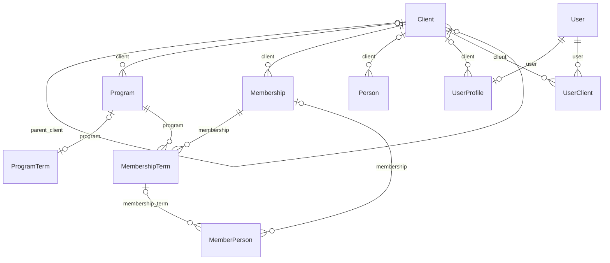

# Core membership model

[Architecture index](../membership-architecture.md) · Reviewed 2026-10-17

## Answers to the assumptions

| Assumption | Answer from the models |
| --- | --- |
| Clients offer different Programs or Terms. | Clients can have many `Program` records. `Program`, `ProgramTerm`, and `MembershipTerm` mean different things; see the definitions below. |
| Clients have members. | Yes, through `Membership.client`. Covered people are stored separately as `MemberPerson` records associated with memberships and terms. |
| Members subscribe to MembershipTerms for a specific Program. | More precisely, a `Membership` has many `MembershipTerm` records. Each term requires exactly one membership and one program. Covered people attach to the term through `MemberPerson.membership_term`. |
| Members can have multiple active terms across programs and clients. | The schema permits multiple terms per membership, different programs per term, and overlapping or multiple `ACTIVE` terms. It does not enforce a single client across those programs. This permits such records structurally; it is not a guarantee that every business workflow supports them. A `MemberPerson` row itself has only one direct term link. |
| Programs are tightly coupled to clients, including the same program offered by two clients. | One `Program` row has at most one client; its client is nullable. Two clients cannot both own the same program row through this field. Equivalent offerings would require separate program rows. Names can repeat, but `code` and `code_reference1` are each globally unique. |
| Members can be part of multiple clients. | One `Membership` row records exactly one client. A real person can be represented in multiple memberships, including memberships for different clients, but these models do not provide a shared person identity joining those records. Term programs can also point to clients different from the membership's client, as described above. |
| There is a linkage between user and member. | There are inherited audit links such as `created_by`. There is no direct login or identity link from `User` to `Membership`, `MembershipTerm`, or `MemberPerson` in these models. |
| There is a linkage between user and client. | Yes: `User.clients` is many-to-many through `UserClient`. Separately, `UserProfile.client` is an optional single-client association. |
| All members are definitely users. | No. Member records require a creator user through `BaseModel.created_by`; that user is the actor who created the record, not necessarily the covered person. |
| All users need not be members. | Correct. `User` has no required membership or member-person relationship. |

Sources: [Membership and MembershipTerm](/home/projectds/projects/compass/usac/usac/models/member.py#L405),
[MemberPerson](/home/projectds/projects/compass/usac/usac/models/member.py#L1911),
[Program](/home/projectds/projects/compass/usac/usac/models/programs.py#L123),
[User](/home/projectds/projects/compass/usac/usac/models/user.py#L9), and
[BaseModel](/home/projectds/projects/compass/usac/usac/models/base.py#L15).

## The main entities

| Entity | Meaning | Important relationships |
| --- | --- | --- |
| `Client` | An organization with client codes, business information, type, and status. | Can have many programs and memberships. Optional `parent_client` supports an organization hierarchy. |
| `Program` | A named offering, with status, retail or wholesale type, and configuration. | Has an optional client. Can be selected by many membership terms. |
| `ProgramTerm` | Program-level duration and renewal configuration. | Optional one-to-one `program` link; a program can have at most one attached `ProgramTerm`. Includes `term_in_months`, `term_is_renewing`, and an optional renewal destination program. |
| `Membership` | An account or enrollment grouping identified by a client member ID. | Requires one client; has many membership terms. It does not store a person's name or a direct program foreign key. |
| `MembershipTerm` | A specific enrollment period in a selected program. | Requires one membership, program, status, start date, and end date. Can have many covered people. |
| `MemberPerson` | A covered person, with name, date of birth, member status, and coverage role. | Has optional direct links to a membership and a term. Roles include primary, spouse, child, and other categories. |
| `Person` | A separate general contact/person record. | Optional links to a client, vendor, service location, and provider. It has no direct membership or member-person link and no login identity link to `User`. |
| `User` | An application authentication account extending Django `AbstractUser`. | Requires a user type. Has client associations, permissions, roles, and feature controls. |
| `UserProfile` | Additional account details, including external-user, lock, and disable flags. | Each profile requires a unique user and can reference one client and one vendor. The schema does not require every user to have a profile. |
| `UserClient` | An association between an application user and a client. | Requires one user and one client; implements `User.clients`. |

`ClientContractTerm` is another separate use of “term”: it stores a client's
contract dates and contract settings. It is not a member's enrollment period.
See [ClientContractTerm](/home/projectds/projects/compass/usac/usac/models/client.py#L207),
[ProgramTerm](/home/projectds/projects/compass/usac/usac/models/programs.py#L585),
[Person](/home/projectds/projects/compass/usac/usac/models/person.py#L6), and
[UserProfile and UserClient](/home/projectds/projects/compass/usac/usac/models/user.py#L203).

## Relationship diagram

The diagram shows declared foreign keys and one-to-one links. A circle means the
relationship is optional. Audit links are omitted for readability.

There is no model named `Member` in `member.py`. In discussion, “member” can mean
the membership account, a term, or a covered person; use the explicit model name
when describing relationships.

## How memberships relate to programs and clients

The program belongs to the term. To inspect all enrollments for an account, use
`membership.membership_terms`; each term has its own `program`, status, and dates.
`membership.program`, `program_name`, and `program_object` are convenience
properties, not database relationships. They select one term ordered by
`-last_updated_by`; they do not describe all programs or necessarily select the
latest term by date. `get_latest_term` separately orders nondeleted terms by
`-start_date` and `-created_on`.

There are two client paths:

- `membership.client` is the required client recorded on the account and is used
  when validating the client member ID.
- `membership_term.program.client` is the client associated with the selected
  offering. A comment on `Membership.client` explicitly directs developers to use
  this path to access the client for a term.

The model declarations and save methods do not enforce
`membership.client_id == membership_term.program.client_id`. Consequently,
documentation or reporting must not assume those paths are interchangeable.
Because `Program.client` is nullable, the term's program may also have no client.

For a concrete example, a membership recorded under Client A can have a term for
Program A1 and another term for Program A2. The schema also allows a further term
selecting Program B1 belonging to Client B. That last arrangement illustrates
what the model permits; it does not establish a business rule for enrollment
across clients.

Sources: [Membership fields and program properties](/home/projectds/projects/compass/usac/usac/models/member.py#L405),
[membership ID validation](/home/projectds/projects/compass/usac/usac/models/member.py#L495),
[get_latest_term](/home/projectds/projects/compass/usac/usac/models/member.py#L532), and
[MembershipTerm fields and save](/home/projectds/projects/compass/usac/usac/models/member.py#L548).

## Identity and active status rules

`Membership.client_member_id` is indexed but not globally unique. On creation,
`Membership.save` validates a supplied member ID against the same client. This
check can be bypassed through `CLIENTS_ALLOW_MEMBERSHIP_DUPLICATES` or an instance
override. The model does not declare a database uniqueness constraint on the
client and member ID pair. A client member ID is therefore not a global human
identity.

Multiple active or overlapping terms are not prohibited by the model
constraints. The existing helpers also use different meanings of active:

- `Membership.has_a_active_term` checks for at least one nondeleted term with
  `status.code == 'ACTIVE'`, also requiring the membership to be nondeleted. It
  does not check term dates.
- `MembershipTerm.is_term_active` and `is_today_within_term_range` check
  `start_date <= today < end_date`. They do not check status or deletion, and
  the end date is excluded.

Any rule about “currently active memberships” must specify whether it means
status, date coverage, deletion state, or a combination.

Sources: [membership ID validation](/home/projectds/projects/compass/usac/usac/models/member.py#L495),
[active term status helper](/home/projectds/projects/compass/usac/usac/models/member.py#L450), and
[term date helpers](/home/projectds/projects/compass/usac/usac/models/member.py#L741).
