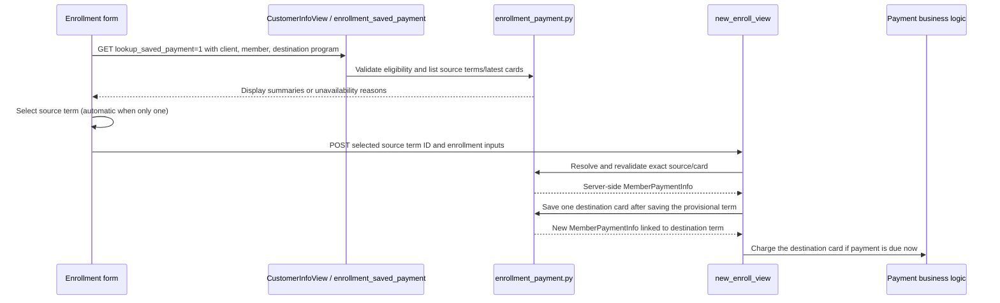

# Enrollment payment reuse

[Architecture index](../membership-architecture.md) · Reviewed 2026-10-27

## Purpose and current scope

At `/member-enrollment/`, an authorized operator can reuse saved payment details
from an existing member's active Roadside term when adding another program.
The initial example was Chevron Family Security and Hospital Accident enrollment;
**the destination program is now unrestricted by product category or program code**.
It must still be an active, non-deleted program for the selected Chevron client.

The three business eligibility conditions are:

1. The operator is authenticated and has `ENROLLMENT_CLONE_PAYMENT` through
   `has_system_module_feature()`.
2. The selected client is Chevron, identified by client code `10242` by default
   (`ENROLLMENT_REUSE_PAYMENT_CLIENT_CODE` can override it).
3. An existing client member ID has been provided.

The UI waits for a positive numeric destination program ID before showing the
saved-card radio option or running the lookup. Placeholder `0` is not a selection.
This avoids showing a missing-program warning while the form is incomplete.
Server-side validation remains necessary for direct requests and enrollment POSTs.
If the operator has explicit `User.clients` associations, the selected client must
be among them. A member with an active or scheduled non-deleted term for the same
destination program is rejected by this feature's target validation.

## Source-term lookup and card eligibility

`_active_roadside_terms` selects terms with:

- Non-deleted term and membership, with term status `ACTIVE`.
- The supplied client member ID and a program belonging to the selected client.
- A non-deleted source program and at least one non-deleted Roadside
  `ServiceBenefitAmount` record; see [benefit classification](programs-and-benefits.md).
- A different program from the destination program.

The query uses status-based active eligibility; it does not additionally compare
term start/end dates with today or require the source program's status to be active.
The account scope uses client member ID plus `term.program.client`, rather than a
single Membership primary key. Duplicate accounts may therefore produce several
candidate terms; the selected source term determines the account used on POST.

The selected term contributes its latest non-deleted payment record, ordered by
ID descending, matching `MembershipTerm.latest_member_payment`. If that latest
record is a check or another non-card method, the term is unavailable; the lookup
does not fall back to an older card. There is no per-term card chooser.

Card active status, expiry, last-four formatting, credentials, vault/token presence,
and source/destination merchant compatibility do not block reuse. The selected
record is copied as-is for its payment metadata, including active, preferred and
vault state. Destination configuration and processor failures follow the existing
payment flow; removing selection checks does not create a customer payment link.
Lookup responses contain only terms whose latest payment record is a card. Each
item includes the source term ID, program name and term dates. Card IDs, card type,
last four digits, expiry and credentials are not sent to this reuse UI.

## UI behavior

Eligible inputs trigger a debounced lookup. With one eligible source term, it is
selected automatically and its term details are shown. With multiple terms, the
operator selects one from a dropdown. With no eligible terms, an informational
message is shown. There is no card chooser or separate card-confirmation button.
Changing the client, member ID or destination program clears the selection and
invalidates pending responses. A resolved term selection survives form redisplay.
Only the selected source term ID is submitted for reuse. The backend reloads that
member-owned term and obtains its latest card payment record before cloning it.

## Request and payment flow

The lookup uses the existing enrollment URL. Success responses use
`Cache-Control: no-store`; permission failures return 403, validation failures 400.
POST resolves the selected source term ID within eligible member-owned terms and
derives the latest card, account, payment method and metadata on the server. Reuse does not bind or
validate the manual card-entry form, inject synthetic card fields into POST, or
accept submitted card metadata as the source of truth. Manual payment inputs are
disabled in saved-card mode. Reuse adds a term to the existing account rather than
reopening it. Invalid enrollment forms create no clone.

## Existing-term enrollment and payment confidentiality

The existing-term enrollment GET does not initialize manual card fields for a
saved credit card. It supplies a signed reference containing only operator and
payment-record IDs, plus a separate masked account display. This reference path
also accepts only credit cards; check payments remain manual entry. The reference expires after
one hour. POST verifies its signature and operator, reloads the active,
non-deleted payment record, and checks source term/membership deletion, member ID,
membership ID, client access and allowed destination program. It then uses the
source term’s latest payment record, requiring only that it be a card. Existing-term
reopening rules remain separate from Chevron Roadside payment reuse eligibility.
An operator can discard the reference and enter a new payment method.

Enrollment form widgets never echo account credentials or CVV into hidden inputs,
visible inputs, or `data-original` attributes on validation-error redisplays.
Manual payment credentials must be entered again after a failed submission.
Saved-payment references can survive a form redisplay without returning credentials.
Enrollment GET and POST responses are marked non-cacheable. Step 3 no longer logs
original account values or repeats masking in the error-only JavaScript block.

Payment business logic no longer prints vault-update dictionaries or raw sale
results. FluidPay and Payix adapters no longer log raw request payloads, processor
responses, or token values. These changes concern the enrollment paths and their
shared payment adapters; they do not establish that unrelated account-maintenance
screens or all other application logging have been audited.

The source payment record is never reassigned to the destination term.
`clone_enrollment_payment` creates one new `MemberPaymentInfo`
after the destination term is saved and before any enrollment charge. Both immediate
and deferred enrollment use this helper. The explicit copy list is payment method,
stored account value, expiry, token, vault flag, last four digits, truncated PAN and
card type, active flag and preferred flag. Destination ownership and fresh audit fields are assigned; CVV, prior
authorization flags, case links, deletion metadata and legacy import metadata are
not copied. The generic data-layer clone helper is not used for this flow.

For immediate payment, `charge_credit_card_without_mterm` receives the destination
record as `existing_member_payment_info`. It checks that the record belongs to the
destination term/account and is a credit card. Inactive cards are accepted. It bypasses
manual payment-record creation/deduplication and charges using this record, including
customer-vault token support. Transactions reference the destination record and use
its masked metadata. Enrollment-specific processor, auth/sale, AVS and other checks
continue through the enrollment charge function. Manual card and check callers retain
the existing payment-record creation path.

For deferred payment, the same clone remains attached without a processor call.
Enrollment records the source term and last four digits in a general note. A failed
charge removes the destination term/card while preserving the source membership,
term and payment record; a failure result without a returned payment row still uses
the known destination clone for cleanup. Term/clone creation exceptions explicitly
mark the enrollment transaction for rollback. External processor effects cannot be
reversed by rolling back a database transaction.

Focused regression coverage includes latest-record selection, inactive/expired/non-vault
card acceptance, term-ID ownership resolution, term-only lookup output,
signed references, explicit clone fields, token-only payment, clone-before-charge,
approved/failed results, destination ownership checks, manual check compatibility,
and the enrollment view's invalid-form path. Tests mock processor calls and writes;
they do not perform a live enrollment or charge.

## Payment-link events

Only explicit `creditcard_payment_link` enrollment mode calls the payment-link
sender. The “Payment Link for Enrollment sent” event is created inside that
branch after a successful send response. Saved-card reuse and manual-payment modes
neither call that sender nor create the sent-link event. Previously the event was
unconditional, which produced a misleading “sent: None” entry even when no link
was requested. Existing historical events are not changed by this correction.

## Source map

| Responsibility | Source |
| --- | --- |
| Eligibility, source terms, card validation, display summary | [enrollment_payment.py](/home/projectds/projects/compass/usac/usac/code/business/enrollment_payment.py) |
| GET lookup, enrollment POST binding and payment branching | [views.py](/home/projectds/projects/compass/usac/usac/views.py): `CustomerInfoView`, `enrollment_saved_payment`, `new_enroll_view` |
| Card cloning and charging | [enrollment_payment.py](/home/projectds/projects/compass/usac/usac/code/business/enrollment_payment.py): `clone_enrollment_payment`; [payment.py](/home/projectds/projects/compass/usac/usac/code/business/payment.py): `charge_credit_card_without_mterm` |
| Payment model | [member.py](/home/projectds/projects/compass/usac/usac/models/member.py): `MemberPaymentInfo` |
| Radio option | [step3.html](/home/projectds/projects/compass/usac/usac/templates/usac/member-enrollment/step3.html) |
| Source/card summary | [reuse-payment.html](/home/projectds/projects/compass/usac/usac/templates/usac/member-enrollment/reuse-payment.html) |
| Eligibility, lookup, confirmation | [reuse-payment-script.html](/home/projectds/projects/compass/usac/usac/templates/usac/member-enrollment/reuse-payment-script.html) |
| Payment mode integration | [member_enrollment.html](/home/projectds/projects/compass/usac/usac/templates/usac/mat-admin/member_enrollment.html) |

The setup script is
`scripts/system_settings/CS_3410_clone_payment_info_system_module_setup.py` (the
former trailing spaces in its filename have been removed). It registers `ENROLLMENT_CLONE_PAYMENT` idempotently with
creator user ID 1; registration does not grant user or user-type access. Avoid
hard-coding database-specific feature primary keys in application code.

## Proposed future direction

The user proposed removing the Chevron-only restriction later and supporting
same-client payment reuse as a standard enrollment feature. This has **not** been
implemented. No decision to remove permission checks, broaden source terms beyond
Roadside, or bypass payment/merchant compatibility follows from that proposal.
