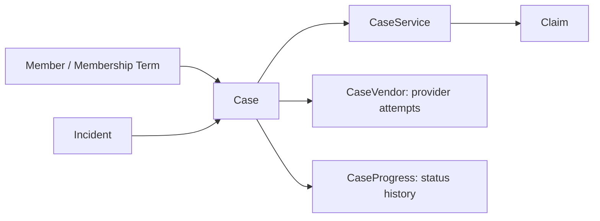
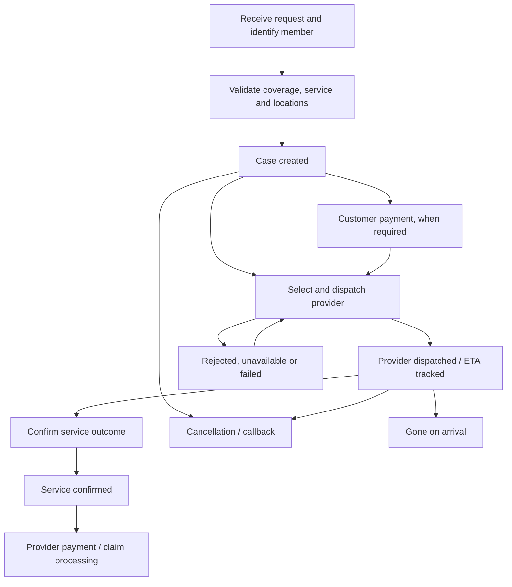

# Compass cases, dispatch, claims, and lifecycle

Reviewed against local source on **2026-10-29**. This describes the current workspace, not confirmation of deployment or live lookup/feature configuration. No application records were changed during the review.

This is a standalone operational reference, separate from the membership architecture modules. Actual screens, status choices, and dispatch options depend on permissions, database configuration, and feature settings.

## What a case represents

A case is the operational record of a request for assistance. It connects the caller/member, incident, vehicle, requested services, locations, providers, dispatch attempts, and follow-up history.

Case handling, dispatch, and claims have separate lifecycles. Service can be confirmed while provider payment or reimbursement processing is still outstanding.

| Record | Purpose |
| --- | --- |
| `Incident` | Intake context, including caller information. |
| `Case` | Overall assistance request and current operational status. |
| `CaseService` | Requested service within a case. A case can have a primary service and additional services. |
| `CaseVendor` | Provider considered or used for the case, including contact, ETA, charges, dispatch and confirmation details. There can be several provider records for a case. |
| `CaseProgress` | Case status history, with timestamps and actors. |
| `CaseServiceProgress` | Service-level progress associated with a CaseService. |
| `DispatchProgress` | Dispatch progress linked to a CaseService, with its own dispatch status and timestamp. |
| `CaseADDProgress` | Automatic dispatch processing history, attempts, and errors. |
| `Claim` | Financial/benefit claim linked to a particular CaseService. |

Sources: [case models](/home/projectds/projects/compass/usac/usac/models/case.py:74), [services](/home/projectds/projects/compass/usac/usac/models/case.py:543), [claim model](/home/projectds/projects/compass/usac/usac/models/claims.py:4).

## Normal operational lifecycle

This is an overview, not a strictly enforced sequence for every case. Provider settlement or a claim is applicable only where the corresponding financial flow exists.

1. **Receive:** identify a member or use a supported No Record/Cash Call path; capture caller, vehicle, service and breakdown location. Towing also requires destination handling.
2. **Validate:** check applicable service questions, benefits, and restrictions. Mileage restriction checks are part of intake, not dispatch status. The towing check includes configured clients and Cash Call scenarios.
3. **Create:** the standard creation handler records CASE_OPENED, then CASE_CREATED. A successful payment-link request can instead leave the case at PAYMENT_REQUESTED.
4. **Dispatch:** find and contact an eligible provider or dispatch network.
5. **Track:** monitor acceptance, ETA changes, provider updates, cancellation, failures, and redispatch.
6. **Confirm:** record completion, unsuccessful service, cancellation, or GOA.
7. **Settle:** process provider charges or claims separately, where applicable.

Sources: [creation handler](/home/projectds/projects/compass/usac/usac/views.py:10376), [initial progress/payment handling](/home/projectds/projects/compass/usac/usac/views.py:10778), [mileage restriction logic](/home/projectds/projects/compass/usac/usac/code/business/case.py:609).

## Case classifications and different flows

These are independent classifications, rather than one case-type field controlling every variation.

| Classification | Variants and effect |
| --- | --- |
| Member identification | MEMBER_ON_FILE uses an existing covered person/term. NO_REC collects required identification/questions when the member cannot be found. CASH_CALL handles assistance at customer expense. |
| Service requested | Towing and other roadside services have different questions, benefit checks, and location requirements. |
| Program/payment arrangement | Covered membership, on-demand programs, and Cash Call can follow different payment paths before dispatch. |
| Additional services | Extra services can be requested on an existing case, with approval/denial and additional charges. |
| Claim-originated case | The membership claim UI can create supporting Case and CaseService records without going through roadside dispatch. |
| Intake source | Internal agent intake, digital receive, and imported/external cases have different entry paths. |

`Case.case_type` points to the TypeCase lookup, whose model comment lists ROADSIDE, ACCIDENT, and SECONDARY. A separate complete workflow for each lookup value was **not established** in this review. The explicit branches traced were driven primarily by member option, service, program/payment settings, and dispatch eligibility.

Sources: [Case and classification fields](/home/projectds/projects/compass/usac/usac/models/case.py:74), [TypeCase](/home/projectds/projects/compass/usac/usac/models/types.py:1292), [member-option seed data](/home/projectds/projects/compass/usac/usac/default_data.py:3681), [additional services](/home/projectds/projects/compass/usac/usac/code/data/case.py:113).

## Dispatch and its relationship to a case

Dispatch assigns assistance to a provider/network and tracks the response. A case may have several attempts: one provider declines, another accepts, or a later failure requires redispatch. CaseVendor retains provider-specific information.

| Dispatch path | Behavior |
| --- | --- |
| Compass | Selects/manages a service provider through Compass; captures contact, ETA, fees, and dispatch details. |
| Digital provider dispatch | Integrations such as Towbook and Atlas exchange requests and provider updates. These are channels within provider dispatch, not separate claim types. |
| Honk | Sends the request to the Honk network and follows job updates. |
| Quest | Dedicated integration path exists. Its tab is currently commented out in the main case template; implementation presence does not guarantee UI availability. |
| Out of Network | Subject to feature settings, case eligibility, vendor availability, and rate checks. |
| Automatic dispatch | Runs provider/network selection and retry processing through background tasks, with separate progress/error records. |

No universal fixed Compass → Honk → Quest order was established. Eligibility and ordering depend on settings and selection logic. Honk/Compass controls can be hidden or disabled and subsequently updated by page JavaScript.

Provider-specific CaseVendor states include:

- PENDING
- AWAITING_RESPONSE
- DISPATCHED
- CONFIRMED
- CANCELLED
- GOA
- SP_UNAVAILABLE_PRIOR_TO_DISPATCH
- SP_UNAVAILABLE_AFTER_DISPATCH

These are distinct from Case.status. The provider model also records dispatch/cancellation/confirmation actors and dates, contact method, dispatch method, ETA changes, and charges.

Sources: [CaseVendor](/home/projectds/projects/compass/usac/usac/models/case.py:706), [dispatch actions](/home/projectds/projects/compass/usac/usac/code/business/dispatch.py:1255), [OON eligibility](/home/projectds/projects/compass/usac/usac/code/business/dispatch.py:733), [automatic dispatch](/home/projectds/projects/compass/usac/usac/code/business/dispatch.py:1633), [digital dispatch endpoints](/home/projectds/projects/compass/usac/usac/api/digital_dispatch/urls.py).

## Case states and closure

| Stage | Representative codes found in source |
| --- | --- |
| Intake/open | CASE_OPENED, CASE_CREATED, PAYMENT_REQUESTED |
| Awaiting assistance | SUBMITTED_TO_DISPATCH, VENDOR_NOT_DISPATCHED, CUSTOMER_WILL_CALLBACK |
| Dispatched | VENDOR_DISPATCHED, CASE_REDISPATCHED |
| Service outcome | SERVICE_CONFIRMED, SERVICE_NOTCONFIRMED, GONE_ON_ARRIVAL |
| Cancellation | CASE_CANCELLED_BEFORE_DISPATCH; CASE_CANCELLED_AFTER_DISPATCH_NO_GOA; CASE_CANCELLED_AFTER_DISPATCH_WITH_GOA; CASE_CANCELLED_BY_CUSTOMER; CASE_CANCELLED_BY_VENDOR |
| Financially settled outcomes | SERVICE_CONFIRMED_AND_VENDOR_PAID, SERVICE_NOTCONFIRMED_AND_VENDOR_PAID, GONE_ON_ARRIVAL_AND_VENDOR_PAID |
| Other | INFORMATIONAL, TEST, DELETED |

These are source/seed definitions, not an enumeration of the live database. In particular, older seed status grouping can differ from groups expected by current code.

“Closed” needs a business definition: the principal operational flow uses service-confirmed, cancelled, and GOA outcomes rather than a single universal CLOSED case state. Provider payment can be a later stage. A CLOSED value in a different service-status lookup is not proof of a universal Case.status closure rule.

The shared `create_case_progress` method changes Case.status and inserts CaseProgress. When a caller passes `verify_confirmed=True`, it refuses selected changes to already-confirmed cases and records review information. That protection is optional, not universal across every caller.

Manual status changes use `/update-case-status/`. Cancellation handling can also request cancellation from an external dispatch integration and invoke payment-collector refund processing. The precise external action depends on the active provider/network.

The Compass confirmation action checks that dispatch evidence exists, updates applicable dispatched provider records to CONFIRMED, and records SERVICE_CONFIRMED progress. Service confirmation does not itself establish that every financial obligation has been settled.

Sources: [case status seeds](/home/projectds/projects/compass/usac/usac/default_data.py:3720), [shared status/history updater](/home/projectds/projects/compass/usac/usac/code/business/case.py:262), [manual status handler](/home/projectds/projects/compass/usac/usac/views.py:19454), [confirmation action](/home/projectds/projects/compass/usac/usac/code/business/dispatch.py:1508), [cancellation post-processing](/home/projectds/projects/compass/usac/usac/code/business/case.py:594).

## Case Queue versus other queues

The Case Queue is an operational view over **Case records**. It is separate from QueueMemberMaintenance, used by WINBACK, MAINTENANCE, PAYMENT, and CASEFEEDBACK.

The queue supports filtering and follow-up work. There is a separate confirmation-results flow using case status, dispatch dates, ETA updates, and dispatch-source information to find cases needing confirmation.

| Route | Selection/purpose |
| --- | --- |
| `/case-queue/` | Main operations queue; excludes specified USPS spreadsheet sources. |
| `/search-case-queue/` | Queue results; also restricts older records using a recent-history cutoff. |
| `/search-confirm-case-queue/` | Separate confirmation selection and pagination. |
| `/search-case/` | General case search, useful when a case is absent from an operational queue. |

The confirmation selector explicitly filters nondeleted cases in SUBMITTED_TO_DISPATCH or VENDOR_DISPATCHED with a dispatch timestamp, then uses dispatch/ETA information. Treat comments about service completion flags separately from enforced predicates; some explicit boolean exclusions are commented out in this implementation.

Sources: [queue views](/home/projectds/projects/compass/usac/usac/views.py:12395), [confirmation selector](/home/projectds/projects/compass/usac/usac/code/business/case.py:102), [membership follow-up queue reference](queue-flow.md).

## Case and claim relationship

The database path is **Case → CaseService → Claim**. A case does not require a claim. The schema permits multiple claims for a CaseService, although UI validation can impose additional rules.

The membership claim handler can create a supporting Case and primary CaseService before creating a PENDING Claim. That is a financial/benefit flow and does not necessarily imply provider dispatch occurred.

Claim has separate status, approval/denial fields, claimed and paid amounts, dates, and history. Confirming a roadside case does not automatically mean a claim is paid. Provider settlement has separate records as well; it should not be equated with a member reimbursement claim.

Sources: [Claim model](/home/projectds/projects/compass/usac/usac/models/claims.py:4), [claim creation handler](/home/projectds/projects/compass/usac/usac/views.py:15137).

## UI paths for management and tracing

| UI path | Purpose |
| --- | --- |
| Case → New: `/new-case/` | Intake and creation. The screen submits its normal creation request to `/create-case/`. |
| Case → Search: `/search-case/` | Search by case/account/customer criteria. |
| Case → Queue: `/case-queue/` | Operational dispatch/follow-up lists. |
| Case → Dispatch: `/case-dispatch/` | Dispatch-oriented case view. |
| Open case: `/view-case/<id>/` | Existing case screen. Despite the route argument name `case_number`, this handler looks up the database primary key. |
| Receive tab | Review member/caller, vehicle, service, locations, and intake information. |
| Dispatch tab | Provider/network actions and tracking, subject to availability/settings. |
| Event tab | Trace case events, remarks, and status history. |
| Actions tab | Existing-case actions; rendered when a case exists. |
| Case → Auto Dispatch Progress | Track background selection, attempts, retries, and errors. Routes include `/case/dispatch_progress/` and `/case/dispatch_progress/<case_number>`. |
| Membership → Claims / Claims Search | Follow the financial claim separately; claim search is `/search-claims/`. |

The current case screen is `templates/usac/case/create-case.html`, reused by ViewCase. Older case templates contain commented tabs and should not be assumed to define the current screen. Sidebar links and action availability depend on page/user permissions and feature settings.

For tracing one request, start with its case, inspect Event/status history, inspect provider/dispatch history and ETA updates, then inspect automatic-dispatch progress if applicable. Follow the CaseService link to claims when investigating reimbursement or benefit payment. Use both the displayed case number and database ID correctly for the endpoint involved.

Sources: [routes](/home/projectds/projects/compass/usac/usac/urls.py), [sidebar](/home/projectds/projects/compass/usac/usac/templates/usac/leftside-bar.html:82), [current screen](/home/projectds/projects/compass/usac/usac/templates/usac/case/create-case.html), [ViewCase](/home/projectds/projects/compass/usac/usac/views.py:12667).

## Review limits

- This is a source-based overview, not an exhaustive transition matrix for every integration or client-specific rule.
- Live lookup records, feature grants, scheduled task deployment, and third-party behavior were not queried or exercised.
- Lookup field allowances are distinguished from verified operational branches. ROADSIDE/ACCIDENT/SECONDARY were not each proven to have a distinct enforced lifecycle.
- No customer information, credentials, tokens, or secrets are included.
